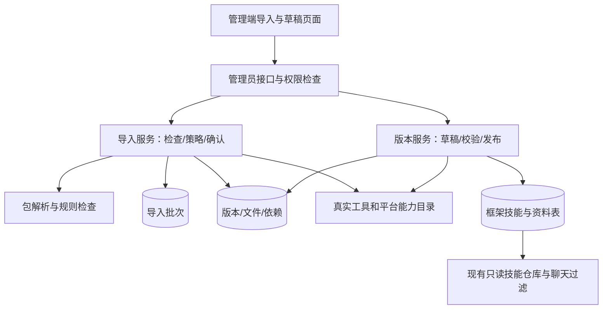
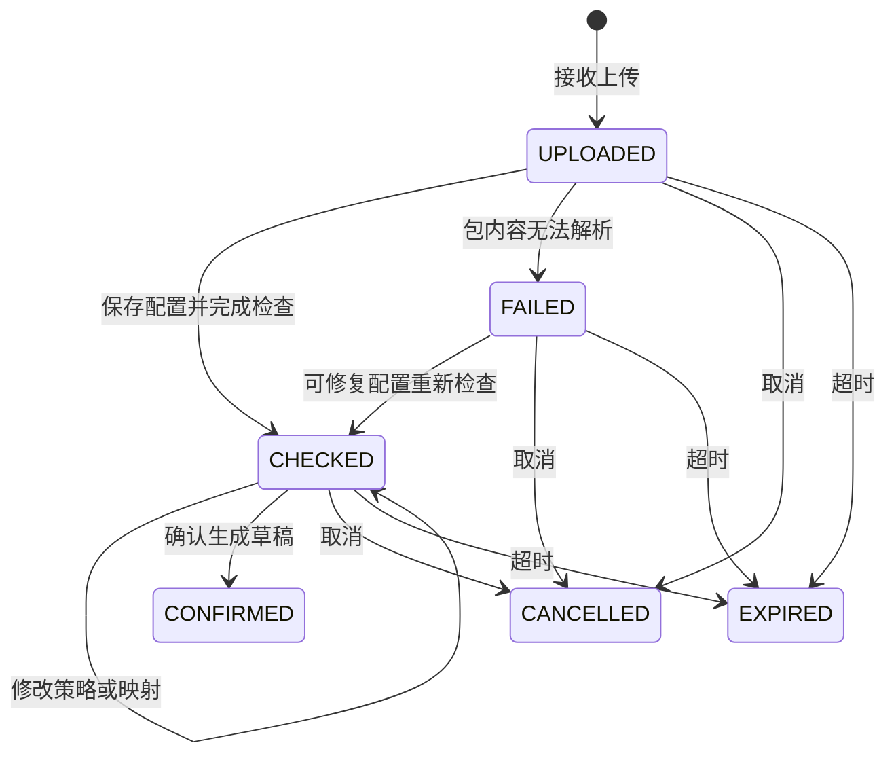

# 海卓大脑：Skill 包导入与版本发布设计

日期：2026-11-23。状态：数据库方案已确认，本文整合数据库与接口设计，供实现评审；相关新功能尚未实现，V12 尚未执行。

## 1. 目标与范围

按照 Figma Skills 管理的导入设计，完成“选择文件 → 检查与策略 → 资源与规则 → 导入草稿结果”，并提供查看原包、编辑草稿、发布版本的后续操作。

管理员应能理解原包包含什么、平台如何处理、哪些依赖已映射、哪些能力仍待接入，以及导入是否改变了正在使用的技能。导入成功表示生成草稿；发布成功表示更新运行内容；启用状态独立维护。

本次不实现完整 MCP 管理、Agent 固定版本、调用结果核验、通用审计日志、脚本执行及技能灰度发布。保留这些页面入口不代表已有对应后端能力。

相关文档：

- [数据库缺口评审](2026-11-23-skill-import-database-gap-review.md)：现状与表字段依据。
- [接口契约](2026-11-23-skill-import-api-design.md)：路由、请求响应、错误码与幂等规则。
- [建表 SQL](../../../ag-ui/src/main/resources/db/mysql/V12__skill_import_version.sql)：四张业务表、字段注释和索引。
- [当前技能管理设计](2026-11-23-skill-management-design.md)：既有正文、资料、可见性与 Agent 绑定规则；其中直接写运行表的新增/编辑/导入行为在版本流程上线时按本文切换。

Figma 参考：https://www.figma.com/design/vngp7ab8i9Jiwj537Rajqz/?node-id=7-1502 。本文范围对应 Skills 的检查与策略、资源与规则、草稿结果及直接关联的原包和发布功能。

## 2. 当前实现与核心决策

现有 `SkillAdminServiceImpl.importDocument` 解析上传内容后直接写入 `agentscope_skills` 和 `agentscope_skill_resources`，同名返回 409。现有表可以保存正文、文本资料、可见范围、启停，但没有导入批次、独立草稿和版本历史。

本次采用以下决策：

1. 保留框架表作为运行内容，框架字段名、主键、source 和读取机制保持兼容。
2. 新增四张业务表保存导入、版本、文件和依赖；草稿不进入框架表。
3. 原包上传字节、原包文件快照与拟发布正文分别保存，管理员查看原包时不会读到被改写的入口正文。
4. 先校验再发布；发布接口本身必须重新核验，前端展示的“校验通过”不能代替提交时检查。
5. 现有 Agent 绑定仍指向 Skill。发布更新该 Skill 的运行内容，不构成按 Agent 固定历史版本。

## 3. 用户流程与页面行为

| 页面/步骤 | 展示和操作 | 完成条件 |
| --- | --- | --- |
| 选择文件 | 选择 MD 或 ZIP，展示文件名、大小与上传结果 | 接收完成，得到批次 ID |
| 检查与策略 | 包名称/版本、结构检查、同名识别、入口和内容处理策略、可见范围 | 配置已保存；检查报告可解释 |
| 资源与规则 | 建议映射、真实候选工具、平台能力、待接入依赖与原包约束 | 所有依赖被明确处理；必要确认完成 |
| 草稿结果 | 目标 Skill、包版本、草稿状态、处理方式、保留文件及警告 | 确认事务成功，得到版本 ID |
| 草稿详情 | 拟发布正文、资料、依赖、规则、可见范围和校验结果 | 保存草稿或进入发布 |
| 发布确认 | 平台发布版本号、影响说明与阻断项 | 服务端重新校验并提交成功 |

导入结果页提供返回列表、查看原包和查看导入详情。未发布的 platformVersion 显示“未发布”，不把包版本当平台发布版本展示。

待接入依赖允许按原包规则保留为草稿；页面同时说明是否阻止发布。同名导入明确提示将新增该技能的草稿版本，必须确认，不能静默覆盖当前内容。

导入批次 ID 和版本 ID 写入可恢复的页面地址参数；刷新通过详情接口恢复服务器状态，不能只依赖 React 内存。切换步骤前保存成功再前进。revision 冲突展示刷新提示，保留本地输入供用户核对，不自动覆盖服务器结果。

取消针对未确认批次；已生成的草稿不能通过“取消导入”删除。原件已清理时显示不可下载状态，不能继续展示有效下载按钮。

## 4. 模块职责与数据流

沿用当前 Controller → Service → Mapper/Bean 分层，不新增一套通用工作流引擎或消息队列。

| 模块 | 职责 |
| --- | --- |
| 导入 Controller | multipart 流量限制、管理员鉴权、参数解析及 DTO 转换 |
| 导入 Service | 批次归属、检查报告、策略转换、映射暂存、确认幂等及事务 |
| SkillDocuments/检查器 | 解析包、规范路径、技术限制、原包规则及拟发布入口生成；不负责数据库事务 |
| 资源目录适配 | 从现有真实 MCP 注册/发现结果和平台能力注册表返回稳定键；不执行业务工具 |
| 版本 Service | 草稿保存、版本文件管理、发布检查、发布事务及运行内容投影 |
| Mapper/Bean | 四表持久化、revision 条件更新、必要的行锁与唯一约束 |
| 前端 | 展示状态、保存选择、规则确认、冲突恢复；不决定最终发布资格 |

工具目录不可用返回明确错误，不能回退到前端模拟数据。目录读取和外部发现不在数据库事务中等待长时间网络响应；提交前使用最新可用目录状态重验。外部服务之后仍可能变化，运行期继续处理真实工具错误。

## 5. 数据模型与存储规则

| 表 | 用途 | 关键约束 |
| --- | --- | --- |
| ai_skill_import | 原始上传、策略、检查、确认和结果 | 操作人+请求键唯一；确认结果关联唯一草稿 |
| ai_skill_version | 草稿/发布内容及规则快照 | 技能名+内部序号唯一；平台版本号技能内唯一；来源批次唯一 |
| ai_skill_version_file | 版本内文件字节与摘要 | 版本+规范路径唯一 |
| ai_skill_version_dependency | 源依赖到目标能力的映射 | 版本+源依赖标识唯一 |

新增表沿用 V11 Skill 业务表风格：自增 BIGINT UNSIGNED、gmt_create/gmt_modified、DATETIME(3)、utf8mb4_unicode_ci、中文 COMMENT、uk_/idx_ 命名。引用框架技能 ID 使用原有有符号 BIGINT。关联由服务层校验，不新增外键或软删列。

确认前尚无版本 ID。placement、dependencyDrafts、confirmations 随检查报告暂存在 import.check_report_json，文档包含 schemaVersion。目标名和两种策略用独立列作为唯一真值。确认事务再将暂存内容写成版本及子表记录，避免提前产生无主依赖。

packageVersion 保存原包声明；platformVersion 保存发布编号；versionNo 仅为技能内内部序号。版本序号分配须处理并发唯一冲突，不能直接无保护 MAX+1。公开、本部门、仅本人沿用现有范围值；管理员编辑或发布不转移原技能归属。

上传原件暂存于 MEDIUMBLOB，适合当前 2MiB 上限。文件内容保留原始字节并计算 SHA-256。原件保留期限与未完成批次 expires_at 是不同概念，不能按批次过期时间清理已确认原件。正式设置清理周期前保留已确认原件；清理实现必须同步维护 sourceAvailable。关联中的发布版本、文件、依赖不得随批次到期级联误删。

数据库可以容纳二进制文件，不代表当前解析器已支持所有类型。第一阶段保留当前上传限制；ASSET 类型只有在解析器、下载和发布投影规则一并完成后才对外开放。

## 6. 状态流转

CHECKED 表示检查完成，仍可能有 ERROR 阻断项；canConfirm 是根据最新报告、映射和确认情况计算的结果。结构损坏需要重新上传，不能通过修改策略修复原始字节。CONFIRMED、CANCELLED、EXPIRED 为批次终态。

版本状态：DRAFT → PUBLISHED；ARCHIVED 预留表示历史归档，本次不暴露归档操作。已发布内容不可原地编辑，修改须复制成新草稿。启停仍属于运行技能的 status，与版本状态独立。

依赖使用 MCP_TOOL / PLATFORM / UNRESOLVED；映射状态使用 SUGGESTED / CONFIRMED / PENDING。建议映射不等于管理员确认。待接入不必然阻止导入，但必需规则未满足必须阻止发布。

## 7. 接口与错误约定

接口详情以独立接口契约为准。本设计中最主要的命令为：

| 阶段 | 接口 |
| --- | --- |
| 上传 | POST /api/admin/skill-imports |
| 恢复导入 | GET /api/admin/skill-imports/{id} |
| 检查策略 | PUT /api/admin/skill-imports/{id}/configuration |
| 候选资源 | GET /api/admin/skill-resource-options |
| 依赖映射 | PUT /api/admin/skill-imports/{id}/dependencies |
| 导入确认 | POST /api/admin/skill-imports/{id}/confirm |
| 草稿编辑 | PUT /api/admin/skill-versions/{id} |
| 发布前检查 | POST /api/admin/skill-versions/{id}/validate |
| 发布 | POST /api/admin/skill-versions/{id}/publish |

沿用管理员鉴权及直接返回 JSON 资源的风格；错误保留 error 并扩展 code/details。BIGINT ID 和 revision 以字符串传输；新表时间按 UTC 约定读写，新接口输出 ISO 8601 带 Z。分页继续使用 items/total/page/size。

新建批次使用上传 Idempotency-Key；更新携带 revision。未登录 401、非管理员 403、不可见批次 404、并发或幂等冲突 409、过期/原件清理 410、超限 413、不支持类型 415、规则阻断 422、目录暂不可用 503。

## 8. 事务、幂等与并发

### 8.1 上传与检查

流式限制体积后接收上传。技术校验失败的已接收原件及报告可以追溯；不能先无上限聚合整个上传流。报告保存独立于后续草稿创建事务，确认失败不能抹掉此前检查报告。

相同操作人和请求键上传相同输入返回既有批次；不同输入返回幂等冲突。策略改变使旧检查和映射确认失效；状态和 revision 一起条件更新。

### 8.2 确认导入

事务内锁定批次，复核创建人、有效期、revision、报告及确认要求，创建版本/文件/依赖，再写入批次确认信息和结果摘要。任意写入失败整体回滚。

已确认批次的重复请求返回原结果，不新建版本，不重新应用请求中的策略。版本表来源批次唯一约束作为最后一道防重复保护。

### 8.3 发布

发布先核验内容、规则、能力与权限；事务内按技能串行化并重新确认目录状态，更新框架表及资料、写版本发布状态。新技能创建冲突依靠名称唯一约束处理，已有技能锁定原技能行。运行表正文与资料不能跨事务分别提交。

发布已有技能保持 id/source/created_at/status/绑定及原归属，按发布内容更新正文、用途和可见范围；新技能首次发布默认为停用，不自动绑定 Agent。启用沿用独立管理操作。

已发布版本对同一平台版本号重试只返回既有结果，不再次投影；后续已发布更新版本时也不能被旧请求回退。当前未增加运行版本指针，管理页面不得仅凭历史时间标记“当前生效版本”，运行内容以框架表为准。

## 9. 权限、文件与运行兼容

所有新接口包括下载均要求平台管理员。导入批次限制创建人访问；版本允许管理员维护，发布规则在后端执行。来源规则和 required 标记不允许客户端任意删除或修改以绕过校验。

参考资料路径继续拒绝绝对路径、路径穿越、重复路径；按表排序规则处理大小写冲突。文件 ID 必须属于请求版本。文本按 text/plain 预览，二进制附件下载，设置 nosniff；保留脚本仅用于追溯，不执行。

框架仓库继续只读，由既有绑定、启停、可见性过滤计算聊天可用技能。发布不会重建框架表或更改 source。原包文件只有符合现有框架加载规则的部分才投影到运行资料表。

## 10. 迁移与实施顺序

1. 只读核实实际 MySQL 表结构、V6/V11 状态和存量数据，备份后手工执行 V12；本次文档不代表已执行。
2. 初始化存量技能为基线发布快照；通过 skill_name/内部序号的确定性规则使迁移可检查、可重跑。保留框架 ID、内容、归属、启停和绑定；无原件则明确无原件，无证据的包版本不伪造。
3. 实现批次上传、报告、策略、真实资源目录和依赖暂存。
4. 实现事务确认、草稿查询编辑、原包和版本文件读取。
5. 实现校验和发布事务、幂等与并发控制。
6. 前端切换四步流程及草稿页面；与关闭旧新增/编辑/直接导入接口一起交付，旧写入口返回 410，避免绕过发布检查。旧技能物理删除接口对存在版本历史的技能返回 409 VERSION_HISTORY_EXISTS，界面提供停用，防止留下悬空历史引用；涉及历史清理的删除流程不在本次范围。
7. 在隔离数据库完成存量与新导入验收后，再部署业务接口。新表和旧代码可以共存，但禁止新版页面接入尚未具备事务保证的半成品接口。

回退到旧代码前必须冻结版本写入并核实运行表内容。保留新表和历史，不在回退脚本中删除数据；若旧直接写接口重新启用，恢复新版前需重新对齐快照，不能把历史版本视为持续可信的运行真值。

## 11. 验收标准

| 场景 | 预期 |
| --- | --- |
| 合法包导入 | 得到批次，四步状态可恢复，最终只产生一个草稿 |
| 草稿保存 | 聊天使用的正文、资料及绑定不变 |
| 同名包 | 明确提示新增草稿版本，未经确认不覆盖 |
| 错误包/超限 | 超限在聚合前拒绝；已接收错误包有可解释报告 |
| 原包规则阻断 | 用户确认不能绕过 ERROR；不满足发布条件返回明细 |
| 待接入依赖 | 原因、能力要求可回显；按规则决定导入/发布资格 |
| 工具发现不可用 | 明确失败，不显示模拟候选为可用 |
| 多标签页编辑 | revision 冲突，不静默覆盖 |
| 网络重试 | 上传、确认和发布按契约幂等，不生成重复版本或回退新内容 |
| 发布中断/并发 | 正文、资料、发布状态一致，无混合版本 |
| 管理员操作仅本人技能 | 不把技能归属转给操作人 |
| 下载 | 批次权限和文件所属校验有效；清理原件后显示不可下载 |
| 存量升级 | 原 ID/source/启停/可见性/绑定保留，无伪造原件 |
| 旧接口 | 无法通过直接新增、编辑、导入绕过新版检查 |

针对事务和并发使用真实 MySQL 隔离库验证；规则和策略用服务测试，界面恢复与错误反馈用前端联调验证。完成表创建不等于业务已实现，接口返回 200 也不能代替对运行表、版本记录和聊天行为的一致性验收。
